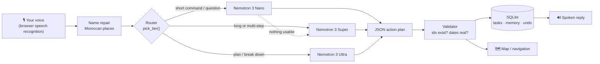

<div align="center">

# Vox

### Talk to your day. Vox takes care of the rest.

A voice-first personal assistant powered by **NVIDIA Nemotron 3** on **Nebius Token Factory**.<br>
You talk like you would to a person, messy and out of order. Vox turns it into tasks, plans,
meeting notes and directions.

**Nebius x NVIDIA Global AI Hackathon** · Personal AI track

[Live demo](#) · [Demo video](#) · [Run it locally](#run-it-locally)


</div>

---

## The idea

To-do apps make you do the organizing: a form, a date picker, a dropdown for priority. Real life
doesn't arrive that way. It arrives as one long sentence while you're walking to class:

> "Ok so I need to finish the hackathon video by Friday, oh and call my mom this weekend, and the
> dentist on Monday, no wait cancel that, and remind me to buy coffee."

Vox hears that and creates **three tasks with real dates**. There is no dentist task, because you
cancelled it halfway through the sentence.

Then it keeps going with you through the day. It records a meeting and tells you what mattered. It
reminds you before a task and asks afterwards whether you did it. When you have to be somewhere, it
drives you there and keeps you company on the way.

## What Vox can do

### 🧠 Understands messy speech
- **Brain-dump.** One rambling sentence becomes many structured tasks, each with a date, time,
  priority and project.
- **Self-corrections.** "No wait", "actually", "cancel that": only the final intention counts.
- **Fuzzy edits.** "Move the video to Thursday and make it urgent", "delete the dentist thing",
  "I already called mom". Vox finds tasks by meaning, not by exact words.
- **Follow-ups.** "Actually, make it Friday" knows what "it" is.
- **Memory.** "Remember my mom is called Fatima." Later, "I called Fatima" checks off *Call mom*.
- **Planning.** "Plan my exam revision, the exam is November 10" gives a dated study plan.

### 🎙️ Meeting mode
- "Record this meeting" makes Vox transcribe the room for as long as you need: a class, a meeting,
  a conversation.
- "Summarize the meeting" gets you the gist, the key points, the decisions and the action items,
  with who owns each one and when it's due. Vox reads the gist aloud.
- One tap adds **your** action items to your tasks. Items other people own stay out.

### 🗺️ Navigation, inside the app
- "Take me to Rabat Ville" opens a map with the route, the distance, the travel time and
  turn-by-turn steps.
- **Start navigation** swoops down onto your position and follows you. You get a live turn banner,
  spoken directions at every turn, a countdown to arrival, and an arrival call-out.
- **Demo drive** simulates the trip, so you can see it all from a desk.
- Tasks that happen somewhere ("pick up the parcel at the post office in Agdal") get a
  one-tap *show the way* link.

### 🇲🇦 Knows Morocco
- 45+ cities, train stations, airports and landmarks are built in. "Fès", "Casa Voyageurs" and
  "Rabat Ville" resolve instantly, with no web search and no chance of landing in another country.
- Speech-to-text often mangles Moroccan names. Vox repairs them before the model sees them:
  *"fess"* becomes Fès, *"rabbit ville"* becomes Rabat Ville.

### 🚗 A co-pilot for the road
- While you drive, Vox goes hands-free and **talks with you**. It opens the conversation, reacts
  to what you say, asks you things, and brings up something new when it's been quiet.
- "Play some music" starts a royalty-free road mix that quietens whenever Vox speaks or listens.
- Task requests ("remind me to call Sara tonight") still reach the task agent mid-drive.

### ⏰ Reminders that follow up
- For every task with a time: a notification 10 minutes before, one at the time, and one
  15 minutes later asking **"Did you do it?"**
- Answer by voice: "yes" checks it off, "not yet" keeps it, and "I did half, move the rest to
  tomorrow" replans it.

### 🎯 Focus mode
- "What should I do now?" shows one task, picked by urgency, and a 25-minute timer.
- Say "done" and the next task comes up.

### 🛡️ Safe by design
- Deleting several tasks at once waits for a spoken or clicked "yes".
- **Every change can be undone** (Ctrl+Z or the undo button), memory included.
- Your tasks and memory live in your own SQLite file. The microphone only opens while Vox is
  listening.

Plus: a morning **briefing** ("brief me"), spoken replies, English / French / Arabic speech
input, hands-free mode, and a live activity log showing which model answered each request and how fast.

## How NVIDIA Nemotron powers Vox

Every request goes to a **Nemotron 3** model on **Nebius Token Factory** through its
OpenAI-compatible API. Vox doesn't send everything to the biggest model. It **routes each request to
the right size**, so everyday commands feel instant and hard ones get the brains they need.

| Tier | Model | Handles | Typical latency |
|---|---|---|---|
| ⚡ Fast | `nvidia/NVIDIA-Nemotron-3-Nano-30B-A3B` | Everyday commands, questions, the briefing, co-pilot chat | ~0.5 s |
| 🧠 Smart | `nvidia/nemotron-3-super-120b-a12b` | Long brain-dumps, multi-step edits, **meeting summaries**, fallback when Nano returns nothing usable | ~1.5–5 s |
| 🔭 Deep | `nvidia/Nemotron-3-Ultra-550b-a55b` | Planning and breaking big goals into steps | ~2–3 s |



The model receives your words, your current tasks, your memory and a two-week calendar. It returns a
JSON list of actions (`add`, `update`, `complete`, `delete`, `remember`, `navigate`…). **The backend
validates every action before anything touches the database.** The routing lives in
[`backend/agent.py`](backend/agent.py) (`pick_tier`).

### Design choices that made it reliable

- **Code does the math, the model does the language.** The model can say `"due": "friday"`, and
  Python turns that into the exact date. The morning briefing is computed in Python (overdue,
  today, urgent), and Nano only phrases it. Small models are fast but bad at calendars, so we don't
  ask them to do calendar math.
- **Validate everything.** An action that points at a task that doesn't exist, or a date that isn't
  real, is dropped before it can do damage. On an update, a bad date is removed rather than set
  to empty, so a mistake can never erase a task's date.
- **Escalate, don't fail.** If Nano returns nothing usable for a request that should change
  something, the same request is retried on Super.
- **Ask before destroying.** Bulk deletes wait for confirmation, and every change takes an undo
  snapshot first.

## Quality: tests and a live eval

```bash
cd backend
python -m pytest -q     # 36 fast tests, no API calls
python evals.py         # 10 real-world scenarios against the live Nemotron models
```

The **pytest suite** covers the safety rules, undo, date resolution, model routing and security
(for example, the static file server can't be tricked into serving `backend/.env`).

The **live eval** runs real requests through Nemotron and scores the resulting database state:
brain-dumps with self-corrections, memory, rescheduling, follow-ups ("actually make it Thursday"),
bulk deletes, French, planning and bulk completion. **Current result: 10/10** (last run
October 29, 2026), with typical latencies of 0.4–0.8 s on Nano, ~2 s on Super and ~3.5 s on Ultra.

## Run it locally

You need **Python 3.11+**, **Node 20+**, and **Chrome or Edge** (for speech recognition).

**1. Backend**

```bash
cd backend
python -m venv .venv
.venv\Scripts\activate          # macOS/Linux: source .venv/bin/activate
pip install -r requirements.txt
copy .env.example .env          # macOS/Linux: cp .env.example .env
```

Put your Token Factory key in `backend/.env` (`NEBIUS_API_KEY=...`). `python list_models.py` lists
the model IDs your key can use. Without a key, Vox still runs in a simple offline mode.

```bash
uvicorn main:app --reload --port 8000
```

**2. Frontend** (second terminal)

```bash
cd frontend
npm install
npm run dev
```

Open **http://localhost:5173**, allow the microphone, and tap the orb (or hold Space).

**One server instead of two:** run `npm run build` in `frontend/`, and the backend serves the
whole app at http://localhost:8000.

**Docker:**

```bash
docker build -t vox .
docker run -p 8000:8000 --env-file backend/.env vox
```

### Things to try

| Say | What happens |
|---|---|
| "Finish the report by Friday, call mom this weekend, and buy coffee" | Three dated tasks |
| "Move the report to Monday and make it urgent" | Finds it by meaning and updates it |
| "Remember my sister is called Sara" | Saved to memory, used later |
| "Plan my exam revision, the exam is November 10" | A dated study plan from Nemotron Ultra |
| "Record this meeting" … "summarize the meeting" | Transcript, then key points and action items |
| "Take me to Rabat Ville" | Map, route and in-app navigation |
| "Play some music" | Road mix, ducked under Vox's voice |
| "What should I do now?" | Focus mode |
| "Brief me" | Your day in one breath |

## Privacy

- Tasks, memory and meeting transcripts are stored in a local SQLite file you control. You can
  delete any memory fact from the Memory tab.
- Speech recognition runs in the browser. Only the recognized text is sent to the backend and to
  Nemotron.
- Maps use free OpenStreetMap services (Photon for place search, OSRM for routes, OSM tiles), so no
  extra API key is needed. Your position is only sent to the routing service, and only while the
  map is open.
- Reminders work while the Vox tab is open. There is no push server.

## Project layout

```
backend/
  main.py          FastAPI routes (commands, confirm, undo, meetings, co-pilot chat)
  agent.py         Nemotron prompts, model routing, action validation, meeting summaries
  db.py            SQLite: tasks, memory, meetings, activity log, undo snapshots
  evals.py         live accuracy check against the Nemotron models
  list_models.py   lists the models your key can use
  tests/           pytest suite
frontend/src/
  App.jsx                    main screen and voice command handling
  useSpeech.js               speech recognition + spoken replies
  useMeeting.js              long-running meeting transcription
  useReminders.js            before / at / after notifications and check-ins
  useMusic.js                road mix with voice ducking
  morocco.js                 built-in Moroccan places and name repair
  components/MapPanel.jsx    map, route and in-app navigation
  components/                voice orb, tasks, meetings, memory graph, focus mode, activity
```

## Built with

**AI:** NVIDIA Nemotron 3 (Nano, Super, Ultra) · Nebius Token Factory<br>
**Backend:** Python · FastAPI · SQLite · OpenAI-compatible SDK<br>
**Frontend:** React · Vite · Tailwind CSS · Framer Motion · Leaflet · Web Speech API<br>
**Maps:** OpenStreetMap · Photon · OSRM

## Team

Built in Morocco by:

- **Aymane Idrissi Khamlichi**
- **Yassine Belaidi**
- **Nassime Gharib**
- **Yahya Dadsi**

## License

MIT, see [LICENSE](LICENSE).
