<p align="center">
  
</p>

<p align="center">
  <b>Nebius x NVIDIA Global AI Hackathon</b> · Personal AI track<br>
  <a href="#">▶ Demo video</a> &nbsp;·&nbsp; <a href="#">🌐 Live demo</a> &nbsp;·&nbsp; <a href="#-ok-how-do-i-run-you">💻 Run it</a>
</p>


## 🎙️ “Vox, what are you?”

> **Vox:** I'm the assistant you talk to the way you'd talk to a friend: messy, out of order,
> correcting yourself halfway through. You ramble, I sort it out. No forms, no date pickers, no
> dropdowns.

<p align="center">
  
</p>

You said four things and cancelled one of them mid-sentence. Vox kept the **three that count**
and gave each a real date. There's no dentist task, because you said *“no wait, cancel that.”*


## 🧭 “What else can you do?”

<table>
<tr>
<td width="50%" valign="top">

### 🧠 Understand messy speech
*“Move the video to Thursday and make it urgent.”*<br>
*“Delete the dentist thing.”* · *“I already called mom.”*

Finds tasks by **meaning**, not exact words. Follow-ups like *“actually, make it Friday”* know
what *it* is.

</td>
<td width="50%" valign="top">

### 💭 Remember you
*“Remember my mom is called Fatima.”*

Later, *“I called Fatima”* checks off **Call mom**. Facts live in your own database, and you can
forget any of them with one click.

</td>
</tr>
<tr>
<td valign="top">

### 🎙️ Take meeting notes
*“Record this meeting.”* … *“Summarize the meeting.”*

The gist, key points, decisions and action items, with **who owns what** and by when. One tap
adds *your* action items as tasks.

</td>
<td valign="top">

### 🗺️ Drive you there
*“Take me to Rabat Ville.”*

A map, a route, then **in-app navigation**: it flies down onto your position, gives a spoken
direction at every turn, counts down to arrival, and has a demo drive for when you're at a desk.

</td>
</tr>
<tr>
<td valign="top">

### 🚗 Keep you company
While you drive, Vox goes hands-free and **talks with you**: it asks things, answers fast, and
picks the conversation back up when it's quiet. *“Play some music”* starts a road mix that
quietens whenever Vox speaks.

</td>
<td valign="top">

### ⏰ Follow up on you
A reminder 10 minutes before, one at the time, then **“Did you do it?”**. Answer by voice:
*“yes”*, *“not yet”*, or *“I did half, move the rest to tomorrow.”*

</td>
</tr>
<tr>
<td valign="top">

### 🎯 Focus you
*“What should I do now?”*

One task, chosen by urgency, and a 25-minute ring. Say *“done”* and the next one comes up.

</td>
<td valign="top">

### 🔭 Plan with you
*“Plan my exam revision, the exam is November 10.”*

A dated study plan from **Nemotron 3 Ultra**, spread over the days before the deadline.

</td>
</tr>
</table>

Plus a morning **briefing** (*“brief me”*), spoken replies, English / French / Arabic speech input,
and an activity log that shows which model answered each request and how fast.


## ⚡ “How do you think so fast?”

> **Vox:** I don't send everything to the biggest brain. Each request goes to the
> **right-sized Nemotron**.

<p align="center">
  
</p>

| | Model on Nebius Token Factory | When | Speed |
|---|---|---|---|
| ⚡ | `nvidia/NVIDIA-Nemotron-3-Nano-30B-A3B` | everyday commands, questions, briefing, co-pilot chat | **~0.5 s** |
| 🧠 | `nvidia/nemotron-3-super-120b-a12b` | long brain-dumps, multi-step edits, meeting summaries, backup when Nano returns nothing usable | ~2 s |
| 🔭 | `nvidia/Nemotron-3-Ultra-550b-a55b` | planning and breaking big goals into steps | ~3.5 s |

The model receives your words, your tasks, your memory and a two-week calendar. It answers with a
JSON plan (`add`, `update`, `complete`, `delete`, `remember`, `navigate`…), and **nothing touches
the database until the backend has checked every action.**

<details>
<summary><b>🔧 The four rules that made it reliable</b></summary>
<br>

1. **Code does the math, the model does the language.** The model says `"due": "friday"`, Python
   works out the date. The briefing's facts (overdue, today, urgent) are computed in Python, and
   Nano only phrases them. Small models are fast, but they're bad at calendars.
2. **Validate everything.** An action that points at a task that doesn't exist, or a date that
   isn't real, is dropped. A bad date on an update is removed rather than blanked, so a mistake
   can never erase a date.
3. **Escalate, don't fail.** If Nano returns nothing usable for a request that should change
   something, the same request is retried on Super.
4. **Ask before destroying.** Bulk deletes wait for a spoken or clicked *yes*, and every change
   takes an undo snapshot first (Ctrl+Z).

The routing lives in [`backend/agent.py`](backend/agent.py), in `pick_tier`.
</details>


## 🇲🇦 “Take me to Rabat Ville.”

<p align="center">
  
</p>

> **Vox:** Off to the station? Where is the train taking you today?<br>
> **You:** Fès, to see my family.<br>
> **Vox:** Nice! How long will you stay in Fès?

That's a real exchange with Nemotron Nano: each reply took about half a second.

- **Knows Morocco.** 45+ cities, train stations, airports and landmarks are built in, so *“Fès”*,
  *“Casa Voyageurs”* and *“Rabat Ville”* resolve instantly, with no chance of landing in another
  country.
- **Hears Morocco.** Speech-to-text mangles Moroccan names, so Vox repairs them before the model
  sees them: *“fess”* becomes Fès, *“rabbit ville”* becomes Rabat Ville.
- **No API key for maps.** It uses free OpenStreetMap services: Photon for search, OSRM for
  routes, OSM tiles for the map.


## 🛡️ “Can I trust you?”

> **Vox:** Check my work.

```bash
cd backend
python -m pytest -q   # 36 tests, no API calls: safety, undo, dates, routing, security
python evals.py       # 10 real-world scenarios against the live Nemotron models
```

```
PASS  brain_dump                 2.1s  nemotron-3-super-120b-a12b
PASS  remember_fact              0.6s  NVIDIA-Nemotron-3-Nano-30B-A3B
PASS  complete_via_memory        0.5s  NVIDIA-Nemotron-3-Nano-30B-A3B
PASS  reschedule_and_prioritize  0.6s  NVIDIA-Nemotron-3-Nano-30B-A3B
PASS  question_changes_nothing   0.4s  NVIDIA-Nemotron-3-Nano-30B-A3B
PASS  follow_up_uses_context     1.9s  Nano → Super
PASS  bulk_delete_asks_first     0.6s  NVIDIA-Nemotron-3-Nano-30B-A3B
PASS  french_command             0.8s  NVIDIA-Nemotron-3-Nano-30B-A3B
PASS  plan_a_goal                3.5s  Nemotron-3-Ultra-550b-a55b
PASS  complete_only_today        0.7s  NVIDIA-Nemotron-3-Nano-30B-A3B

10/10 scenarios passed            (last run: October 29, 2026)
```

**Privacy:** your tasks, memory and meeting transcripts live in a local SQLite file. Speech
recognition runs in the browser, so only the recognized text is sent to the backend and Nemotron.
The microphone opens only while Vox is listening, and your position is used only while the map is
open.


## 💻 “Ok, how do I run you?”

You need **Python 3.11+**, **Node 20+**, and **Chrome or Edge**.

```bash
# 1. backend
cd backend
python -m venv .venv && .venv\Scripts\activate     # macOS/Linux: source .venv/bin/activate
pip install -r requirements.txt
copy .env.example .env                              # then add NEBIUS_API_KEY=...
uvicorn main:app --reload --port 8000

# 2. frontend (second terminal)
cd frontend
npm install
npm run dev                                         # → http://localhost:5173
```

> [!TIP]
> Hold **Space** to talk, or turn on **hands-free**. No key yet? Vox still runs in a simple
> offline mode. `python list_models.py` lists the Nemotron models your key can use.

<details>
<summary><b>🐳 One container instead</b></summary>
<br>

```bash
docker build -t vox .
docker run -p 8000:8000 --env-file backend/.env vox   # → http://localhost:8000
```
</details>

<details>
<summary><b>🗂️ What's where</b></summary>
<br>

```
backend/
  agent.py          Nemotron prompts, routing, validation, meeting summaries, co-pilot
  main.py           FastAPI routes
  db.py             SQLite: tasks, memory, meetings, activity, undo snapshots
  evals.py          live accuracy check · tests/ pytest suite
frontend/src/
  App.jsx           the main screen and voice commands
  useSpeech.js      speech recognition + spoken replies
  useMeeting.js     long meeting transcription
  useReminders.js   before / at / after reminders and check-ins
  useMusic.js       road mix with voice ducking
  morocco.js        built-in Moroccan places and name repair
  components/       voice orb, tasks, meetings, map + navigation, focus mode, memory graph
assets/readme/      these animations (make_svgs.py draws them)
```
</details>


## 👋 “Who made you?”

<p align="center">
  
</p>

<p align="center">
  Built in Morocco with <b>NVIDIA Nemotron 3</b> · <b>Nebius Token Factory</b> · React · FastAPI · Leaflet<br>
  <sub>MIT licensed, see <a href="LICENSE">LICENSE</a>. Every animation on this page is hand-written SVG in this repo.</sub>
</p>
